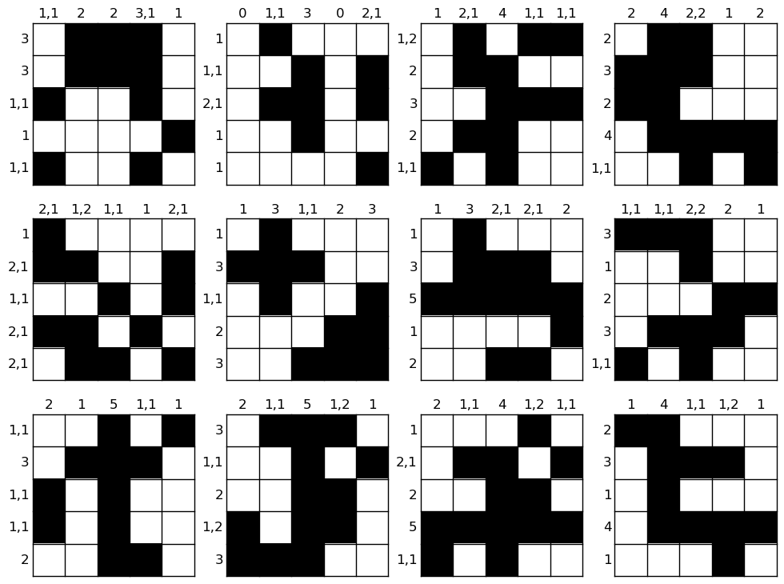
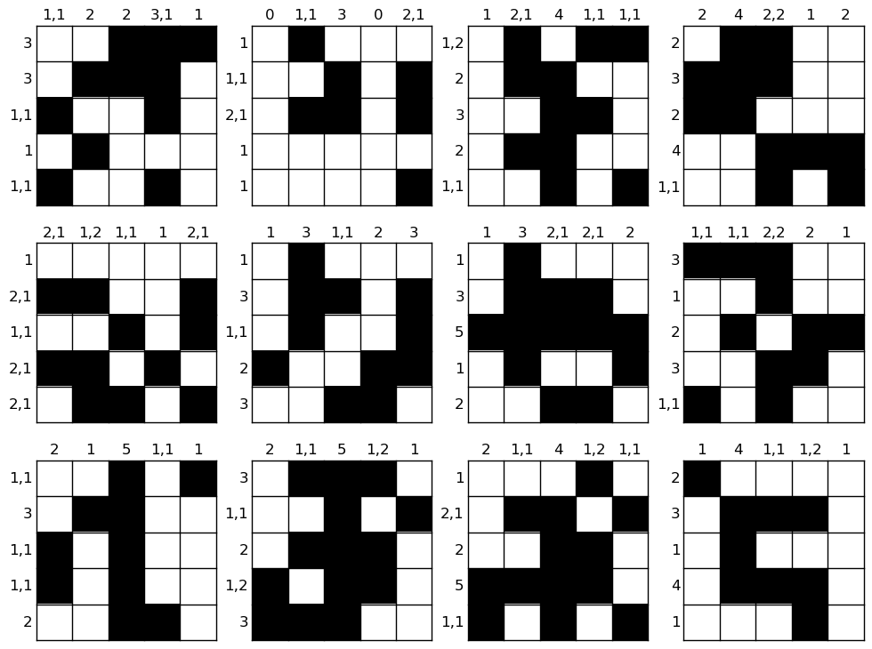
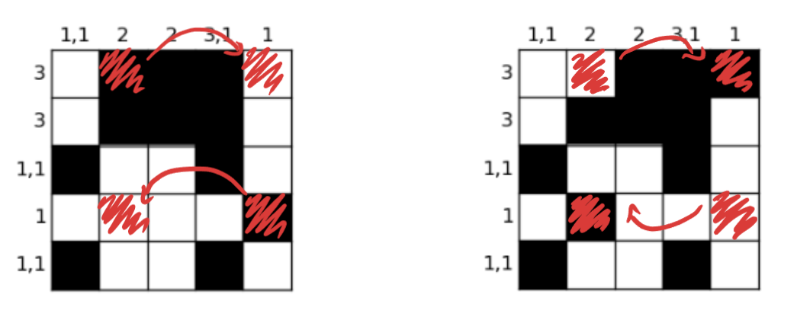
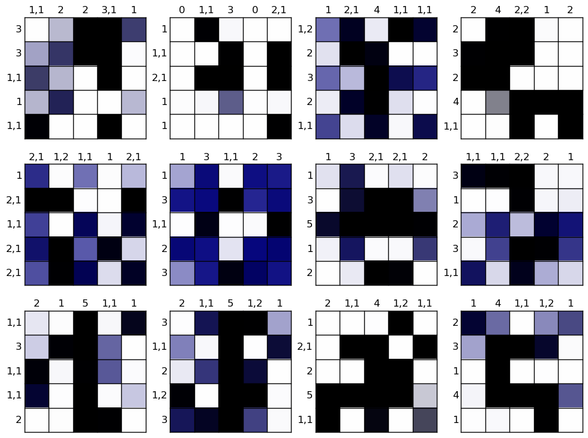

# Incorrect Puzzles

We can look at which puzzles the model got incorrectly and why to get and understanding of the thought processes.

### Specifications
- train dataset: `5x5-700_000-train.jsonl`
- test dataset: `5x5-200_000-test.jsonl`
- model: `recursivegridmlp/09.pt` 
    - gallant-hill-75
    - trained on 5x5 for 100 epochs
    - final val accuracy of 0.98959

### Actual Solutions

These are the true solutions that the model should have gotten.

### Predictions

These are what the model predicted for each of these puzzles (rounded to the closest option).

Interestingly we can see the model has some depeer understanding of the rules. Take the top left for example, it incorrectly places the filled value from the second last row in the last column instead of the second one. Since the evaluation is essentially BCE, it wants to predict as many squares correctly. However, what we see is that it also got another square incorrect, the top row the second and last column were also swapped. This is done because now there is a gap in the last column. This increases the loss (two more incorrect cells) but it also decreases the number of clues the model is violating. This shows that it is likely the model has internally learned the training objective to minimise clue violations.

### Uncertain Predictions

When we introduce the ability to abstain (blue) it works as a measure of how confident the model is with each cell. We can see that the errors the model makes are almost always in places of high uncertainty.

