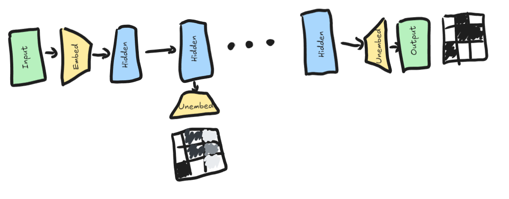
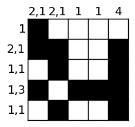
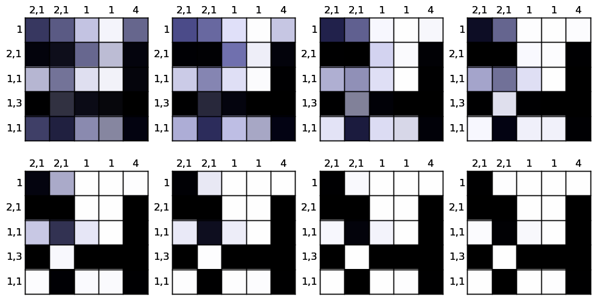
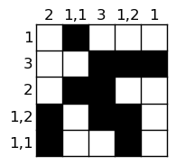
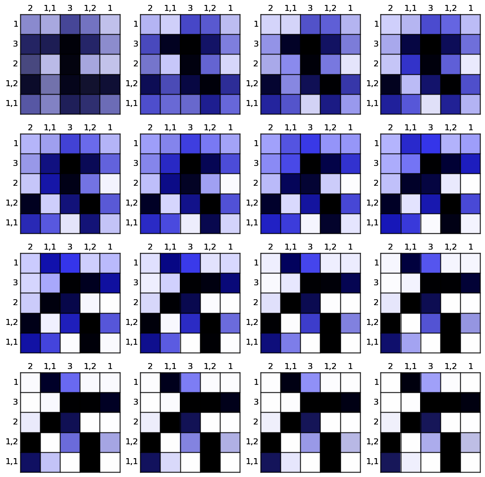

# Logit Lenses

Logit lenses are a way to visualise intermediate predicitons for models. They take the layer you want to look at and apply the model's unembedding, essentially treating that layer as the last layer of the model and seeing what the model would have predicted then.

Since we are using recursive models, the output shape for each layer is the same and we can apply logit lenses to any layer easily. This sequence of "what the model would predict at that layer" will become the solving trace for the neural models.

### Specifications
- train dataset: `5x5-700_000-train.jsonl`
- test dataset: `5x5-200_000-test.jsonl`
- model: `recursivegridmlp/09.pt` 
    - gallant-hill-75
    - trained on 5x5 for 100 epochs
    - final val accuracy of 0.98959

### Uncertainty

We have a loss function that allows the model to abstain, effectively letting us know when the model isn't sure about a square (see `src/neural_models/criterions` AbstainLoss). Ideally we should see in the solving traces that the model is initially uncertain and starts to fill in cells when it becomes confident. In the following diagrams blue represents abstaining/uncertainty.

### Correct Result

Note how in these diagrams it starts uncertain (blue) and gradually becomes more black and white. It also doesn't seem to undo if it's fully certain (from a handful of examples)

### Incorrect Result
This is one where the model fails to get the same result. You can see clearly it is much brighter blue throughout the entire thing (more uncertain). It also takes more steps to reduce this uncertainty. Noteably in the final output, it gets every square correct that it is certain about but still has some uncertain cells (unlike the correct example which had no blue by the end).

