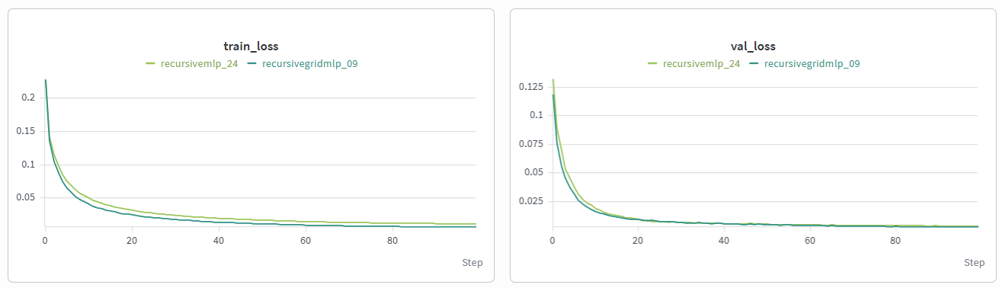
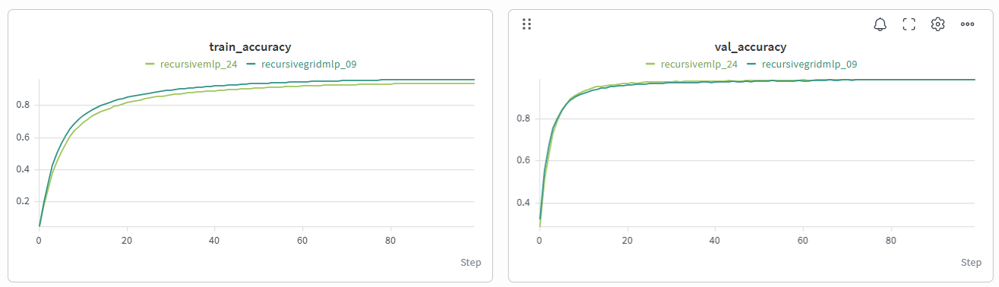
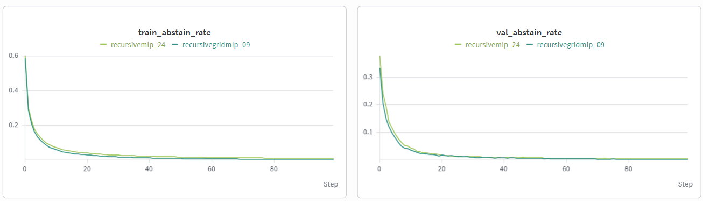

# Model Training

Models were trained and the training logs were logged to weights and biases.

### Specifications

**Recursive MLP**
- model: recursivemlp/24
- model class: `src/neural_models/models/recursive_mlp.py`
- hidden_size: 256
- num_layers: 9
- dropout: 0.3
- loss: AbstainLoss
    - abstain_penalty: 0.2
- optimizer: Adam
    - lr: 1e-3
    - weight_decay: 1e-5
- lr_scheduler: ConsineAnnealingLR
    - T_max: 100

**Recursive Grid MLP**
- model: recursivgridemlp/09
- model class: `src/neural_models/models/recursive_grid_mlp.py`
- hidden_size: 256
- num_layers: 9
- dropout: 0.3
- loss: AbstainLoss
    - abstain_penalty: 0.2
- optimizer: Adam
    - lr: 1e-3
    - weight_decay: 1e-5
- lr_scheduler: ConsineAnnealingLR
    - T_max: 100

**Training**
- 100 epochs
- train dataset: `5x5-700_000-train.jsonl`
- validation dataset: `5x5-100_000-val.jsonl`

### Final Results
Recursive Grid MLP
- train_abstain_rate: 0.01042158226346412
- train_accuracy: 0.9407827854156494
- train_loss: 0.011904045095264215
- val_abstain_rate: 0.004975881004629999
- val_accuracy: 0.9891304969787598
- val_loss: 0.003728199598132348

Recursive MLP
- train_abstain_rate: 0.004043498318860231
- train_accuracy: 0.9653379917144777
- train_loss: 0.0070228637073581155
- val_abstain_rate: 0.003036406135889797
- val_accuracy: 0.9895871877670288
- val_loss: 0.002842538980577065

### Charts

### Comments

- the validation accuracy is consistently higher than the train, likely because of the dropout
- the two models perform very similarly
- The abstain rate (chance the model chooses abstain) goes down over time signalling that as the model performs better, it also becomes more confident with its answers and doesn't need to abstain as pften (though it never reaches 0 completely)